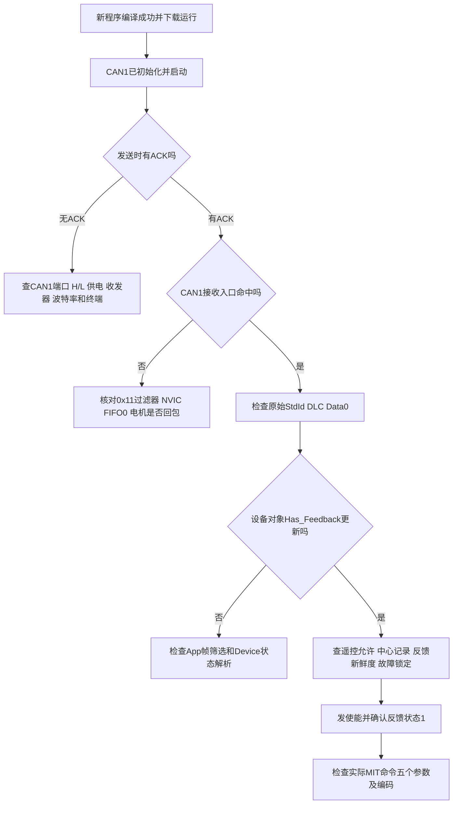

# C板控制达妙电机：按链路定位

## 这次已经确认与尚未确认

- 已确认：电脑USB2CAN能读参数、使能/失能，非零力矩命令能使电机转动。
- 已修复并编译验证：CubeMX再生成时USART3被移除，导致`hdma_usart3_rx`未定义；恢复了句柄、初始化、DMA关联、USART3中断和main启动调用。
- 配置修复已在STM32CubeMX 6.18.1的临时目录生成验证。PC10保留USART3_TX引脚分配，数据方向仍为RX-only；接收仍走PC11。参考工作区的大疆`9.remote_control_dma/remote_control.ioc`。不要将PC10理解为DR16需要的额外接线。
- 已修复：达妙反馈状态2/3/5/7被丢弃。现在这些故障帧也更新反馈，Control把除0/1以外的已识别状态视为故障，保持禁止运行。
- 未确认：修复后的程序在C板上的ACK、收包和实际运动；本轮未烧录。
- 读取状态仍为ID0x7FF、DLC4、数据`01 00 CC 00`。厂家不同例程存在4/8字节差异，其固件兼容性仍需台架核对，本轮未改这个请求格式。

**先重新打开磁盘上的.ioc和Keil工程，再编译下载。CubeMX旧窗口仍持有修复前配置，直接保存或生成可能覆盖修复。** 已生成HEX但尚未替你下载；编译失败后不要把磁盘旧AXF当作刚编译的新程序。

## 沿一条链查，不同时改多个条件



## 每一步看什么

| 顺序 | 观察位置 | 结论的边界 |
|---|---|---|
| 1 程序运行 | main中的App_Init、主循环；SysTick持续更新 | 编译通过和下载成功是两件事；暂停在UART_Poll不是卡死证据 |
| 2 CAN初始化 | CAN1_Manage_Object.CAN_Handler为hcan1的地址，Callback_Function非空 | 说明绑定已完成，不能证明总线有电信号 |
| 3 发送 | CAN_Send_Data中HAL_CAN_AddTxMessage的返回值；CAN1的ESR和TSR | HAL_OK只表示提交到邮箱，不能证明对端收到 |
| 4 接收入口 | CAN1_RX0_IRQHandler中的HAL_CAN_IRQHandler | 未命中时，电机解析函数尚未执行；接收滤波器和中断也可能阻止进入 |
| 5 原始帧 | Yaw_CAN_RxCallback中的frame | 预期标准数据帧，StdId=0x11，DLC=8；Data0高4位是状态、低4位是电机ID低4位 |
| 6 电机解析 | app_init中的yaw_motor.Rx_Data | Has_Feedback是否为true，Last_Rx_ms是否持续更新，Control_Status是否为0/1或故障 |
| 7 操作允许 | gimbal_command.enabled；app_remote中的armed和DR16快照 | 在线、下挡回中过后再上挡才放行 |
| 8 Control | origin_set、fresh、fault_latched、enabling、running | 有反馈不等于允许使能；有使能请求不等于已确认使能 |
| 9 控制参数 | yaw_motor的Control_Angle/Omega/Torque、K_P/K_D及编码后的Tx_Data | 五个参数和实际发出的字节一致，才适合判断MIT响应 |

当前接口：CAN1，1Mbps，控制0x01、反馈0x11，P/V/T_MAX=12.5/30/10。1/0只是反馈中的使能/失能状态，故障帧同样是通信成功的证据。

如果C板没有其他正常CAN节点ACK，打开自动重传后，待发送消息可能持续占用三个发送邮箱，后续HAL_CAN_AddTxMessage返回失败。要区分“进邮箱失败”和“进了邮箱但无法成功发送”。当前工程保留用户开启的自动重传。

有USB2CAN一起接入时，它也可能应答ACK：有ACK证明至少有节点确认合法CAN帧，仍需用0x11的有效状态反馈确认电机应用通信。上位机定时发控制与C板定时发失能也可能互相干扰，测试时只保留一个控制发送方。

断点会停止CPU调度。暂停超过20ms后继续，现有Control会按调度超时停止；清除断点、恢复连续运行后，先下挡回中再上挡。

## MIT现象对应到实际报文

截图的`7F FF B3 20 00 00 09 99`，按当前范围解码约为：位置0、速度12、Kp=0、Kd=0、前馈力矩2。界面输入框虽然写了Kp=2和Kd=2，显示的帧仍未包含这两个非零增益。

先确认点击“更新”后预览帧改变，并核对CAN日志实际发送的帧；预览不一定等于总线上最后一帧。没有位置/速度增益而仅给力矩时，电机空载加速不等于速度控制成功。具体固件版本的KP_MAX/KD_MAX参数读取仍未确认，不建议用猜测参数去刷固件。

## 故障定位后再看：ESR表达式

```cpp
(hcan1.Instance->ESR >> 4) & 7
```

- `hcan1`是HAL维护的软件句柄。
- `hcan1.Instance`指向CAN1硬件寄存器区。
- `->ESR`读取Error Status Register，即错误状态寄存器。
- 其中LEC（最近一次错误类型）占bit6～bit4，总共3位。
- `>>4`把这3位移到bit2～bit0。
- `&7`即`&0b111`，只保留最低3位。

例如ESR的相关位是`011 0000`（0x30），右移4位得到`011`，再与`111`相与，结果就是3，也就是ACK错误。其他位可能同时非零，所以不能直接把整个ESR与3比较。

这相当于从一张包含多个字段的表里取出LEC这一列。表达式只读寄存器，不会开启重传或清故障。LEC描述最近错误；单次读到0不等于所有通信都成功，单次读到3也不能证明电机库解析出错。

硬件位定义见`Drivers/CMSIS/Device/ST/STM32F4xx/Include/stm32f407xx.h`中的CAN_ESR_LEC_Pos和CAN_ESR_LEC_Msk；HAL将LEC识别为ACK错误的逻辑在stm32f4xx_hal_can.c中。
