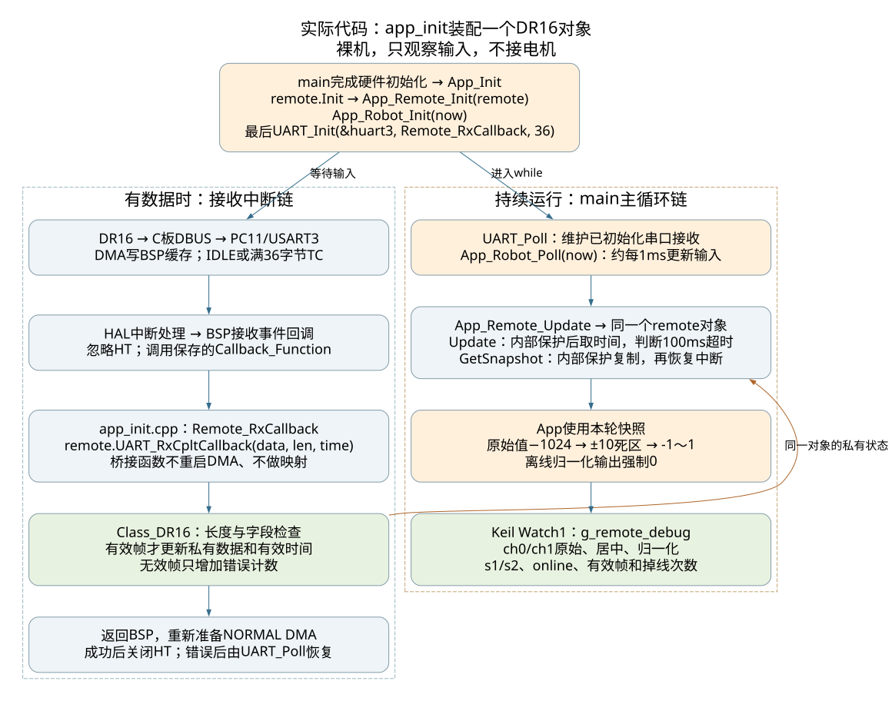

> 历史阶段说明：本文描述DR16观察练习。当前已接通小yaw，移除了g_remote_debug；请先读[当前小yaw MIT练习](小yaw_MIT练习.md)。

# DR16类练习：从8a2aa35接通一条输入链

日期：2026-11-05。仍在`lab/dr16-dbus-input`，本轮不提交。没有Service、BoardRemote、RTOS、电机对象或电机控制发送。



## 对象和各文件

| 文件 | 本轮职责 |
|---|---|
| `Core/Src/main.c` | 硬件初始化后调用App_Init；主循环先UART_Poll，再App_Robot_Poll(HAL_GetTick()) |
| `User/App/app_init.cpp` | 只在此定义一份static Class_DR16 remote；初始化、传引用、绑定串口回调 |
| `User/Device/device_dr16.cpp/.h` | 类私有状态、18字节解包、合法性校验、100ms超时、内部保护快照 |
| `User/App/app_remote.cpp/.h` | 保存同一对象的指针，读取快照，计算通道0/1的死区与映射，写Keil观察结构 |
| `User/App/app_robot.c/.h` | 用传入的毫秒时间每1ms刷新一次App_Remote；不调用Control或电机 |
| `User/BSP/bsp_drv_uart.cpp/.h` | DMA接收、HT屏蔽、回调分发、发送通用接口与错误后非阻塞恢复 |
| `Core/Src/usart.c`、`dma.c`、中断文件与`.ioc` | USART3/PC11、DMA1_Stream1 Channel4及中断配置 |

app_init.cpp允许接触具体HAL句柄，这是集中装配位置。app_remote和app_robot不包含HAL或BSP头。设备类.cpp使用本板main.h提供的计时/临界区操作；公共设备头不暴露HAL类型。将来MC02要适配真实硬件，不把这次练习描述成已经支持H7。

## 1. 上电谁调用谁

```text
main
  HAL/时钟/GPIO/DMA/CAN外设/UART外设配置
  → App_Init
    → remote.Init()：原始通道中位1024、拨杆未知、在线0
    → App_Remote_Init(remote)：保存对象地址、准备观察数据
    → App_Robot_Init(now)：准备1ms调度计时
    → UART_Init(&huart3, Remote_RxCallback, 36)：最后启动接收
```

`MX_CAN1/2_Init`仍是原Core外设配置；本练习未调用CAN_Init/HAL_CAN_Start，也没有实例化或使能电机。

## 2. 回调地址在哪里传、存、用

```cpp
// app_init.cpp
static Class_DR16 remote;

static void Remote_RxCallback(uint8_t *data, uint16_t length)
{
    remote.UART_RxCpltCallback(data, length, HAL_GetTick());
}

// 初始化时传的是函数地址，此时不执行回调
UART_Init(&huart3, Remote_RxCallback, DR16_RX_BUFFER_LENGTH);
```

UART_Init在BSP里保存`port->Callback_Function = callback`，再启动HAL_UARTEx_ReceiveToIdle_DMA。收到IDLE或TC事件后：

```text
USART3_IRQHandler / DMA1_Stream1_IRQHandler
  → HAL处理
    → BSP实现的HAL_UARTEx_RxEventCallback
      → port->Callback_Function(port->Rx_Buffer, size)
        → app_init里的Remote_RxCallback
          → 同一个remote对象的UART_RxCpltCallback
            → 长度/通道/拨杆/按钮检查，更新有效状态
      ← 回到BSP，准备下一轮NORMAL DMA
```

BSP覆盖HAL同名弱回调，不是先执行一个HAL空回调、再执行另一个同名函数。app_init的桥接回调不重启DMA、不做输入映射，也不控制电机。

Class只接受18或36字节；36按两个18字节检查。坏长度整块丢弃，下一完整帧恢复。坏内容不更新最后有效时间。DBUS无可在这里验证的帧头/CRC，字段合理性检查不能识别所有误码。

## 3. 主循环与掉线

```text
while
  → UART_Poll：恢复已经结束的接收；BUSY_RX保持不动
  → App_Robot_Poll(now)：距上次≥1ms才执行
    → App_Remote_Update
      → remote_device->Update()
         保存PRIMASK → 关中断 → 此时HAL_GetTick → 判断有效帧超时 → 恢复PRIMASK
      → remote_device->GetSnapshot(state)
         保存PRIMASK → 关中断 → 复制整份状态 → 恢复PRIMASK
      → App计算映射，写g_remote_debug
```

两段临界区均由设备内部处理，App不用关中断。Update和GetSnapshot之间若来了新帧，后者会得到新帧完整状态，解析时已经把age置0、online置1。超时计算取时间也在临界区内，避免先取旧时间、后读到更新帧而误判。当前是单核裸机模型，不把此同步方式直接当成通用RTOS互斥。

最后有效帧后99ms仍在线，100ms起离线。每次在线→离线只加一次timeout_count。新有效帧恢复输入在线；这里只观察输入，不代表未来电机自动恢复动作。

原始值保留供排查；离线的归一化映射强制0。RC_CtrlData/RC_InitData/GetRCData等旧可写全局访问已移除，公开接口改为类方法；键鼠保留协议字段，不保留语义不清的旧KeyCount数组。单字母键码宏改为DR16_KEY_*，避免污染CMSIS字段。

## 4. 本轮硬件配置

按DT7＋DR16的18字节DBUS，不适用于直接替换FS-i6X/iA6B的其他输出协议。

| 项目 | 配置 |
|---|---|
| C板接口 | 专用DBUS，板载反相后PC11/USART3 RX |
| UART | 100000 bit/s，有效8E1；HAL字长9B＋偶校验＋1停止位 |
| DMA | DMA1_Stream1，Channel4，NORMAL，字节对齐，36字节 |
| HT | 每次成功启动后关闭；BSP回调也忽略HT |
| IRQ | USART3、DMA1_Stream1，优先级5 |
| USART1 | 保留原115200设置，本练习不启动它的接收 |

C板手册的共享PWM连接器第8组：C8信号、B8为5V、A8为GND。实体插向和线序按板上标识及[官方C板手册](https://rm-static.djicdn.com/tem/35228/RoboMaster%20%20%E5%BC%80%E5%8F%91%E6%9D%BF%20C%20%E5%9E%8B%E7%94%A8%E6%88%B7%E6%89%8B%E5%86%8C.pdf)印刷13/18页核对。

36字节是本轮缓存长度，不是双缓冲。一帧18字节结束后，由IDLE报告长度18；满36字节可走TC。HT在18字节处虽然可能置标志，但被屏蔽，不会把同一帧重复解析。NORMAL接收在解析后重启，存在停止/重启间隙；未宣称零丢帧保证。

`.ioc`与Core手工同步，没有通过CubeMX GUI重新生成；下次生成前后请检查USART3/DMA/中断差异。

## 5. Keil怎么观察

重新加载`MDK-ARM/can_motor_test.uvprojx`，确认app组含app_init.cpp、app_remote.cpp，device组含device_dr16.cpp（头文件已从分组显示中移除，磁盘和include路径保留）；旧同名.c不应再参与编译。已同步uvprojx和uvoptx，避免仅复制文件没加入工程。

这三个新/改名.cpp文件已明确启用C++11，保持与现有中科大C++源文件一致；没有把C文件强制改成C++编译。

Watch1配置：

| 表达式 | 预期 |
|---|---|
| `g_remote_debug` | 展开全部输入观察量 |
| `.ch0_raw`、`.ch1_raw` | 原始364～1684，中位约1024 |
| `.ch0_centered`、`.ch1_centered` | 原始值减1024，约±660 |
| `.ch0_normalized`、`.ch1_normalized` | ±10原始单位死区，外侧连续映射到-1～1；离线0 |
| `.s1`、`.s2` | 原始1/3/2编码，一般上/中/下；实拨确认左右对应 |
| `.online`、`.age_ms` | 有效帧是否新鲜；首次无数据age=UINT32_MAX |
| `.valid_frames` | 有效帧持续增长 |
| `.invalid_lengths`、`.invalid_frames` | 坏长度、坏内容计数 |
| `.timeout_count` | 在线转离线次数 |
| `UART3_Manage_Object` | 展开BSP接收事件、长度、错误、重启和启动状态 |

表内点号字段完整写法例如`g_remote_debug.online`。发送/接收诊断保持在BSP对象里，App不为看窗口再增加一层硬件包装。

上板顺序：下载后Run → 看有效帧增加 → 逐轴记录通道及方向 → 逐挡记录拨杆 → 关遥控器观察100ms掉线和映射归零 → 重开确认恢复。不要在每帧接收处反复打断点，暂停会造成丢帧/串口错误。开启Keil运行时观察刷新，否则窗口未更新不等于程序未接收。

必须实测接收器关遥控后的真实输出；若它一直发有效保持值，单靠有效帧时间无法识别失控。对频成功也不保证软件收帧，还需供电、接线、格式正确。

## 6. 验证范围

主机测试在tests/remote_input，编译真实Class_DR16、app_init回调桥、App映射/调度、UART BSP，只替换HAL硬件。覆盖坏帧、掉线边界、恢复、Tick回绕、HT、错误重启、快照与PRIMASK；报告在Build/remote_tests/result.json。

Keil编译记录在Build/dr16-class-build.log。没有连接实物、没有下载，不能把软件测试当作板上接收已验收。未提交；下一次提交名由用户指定。
