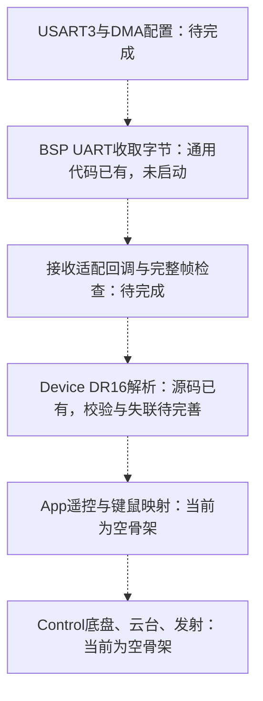

# 裸机App职责与DR16接入现状

## 参考北林时取什么

北林2025英雄的app_init.c集中初始化，app_remote.c中的Remote_ControlCom解释拨杆和键鼠，再设置各模块目标；app_chassis.c等把控制与输出组织起来。它用RTOS任务周期调用这些函数。本工程借鉴职责划分，不复制Remote_Task、osDelay、线程入口，也不把其尚未运行的任务误认为已经启用。

## 目前App应写什么

| 事项 | 本工程入口 | 应该放进去的内容 |
|---|---|---|
| 初始化编排 | App_Robot_Init | 先建设备对象和默认状态，再登记回调、启动接收，最后允许控制 |
| 输入解释 | App_Remote_Update | R切操作方式、C/G切底盘模式，摇杆/WASD转速度，鼠标转云台目标，按键转一次发射请求 |
| 整车状态与许可 | 后续扩展app_robot或独立app_state | 未使能/运行/故障；模式切换、输入/反馈失联、发射与取装互锁 |
| 周期组织 | App_Robot_Poll | 检查时间，先读有效输入并决策，再更新各控制模块，最后组织统一输出 |
| 回调接线 | 后续增加app_communication.cpp等 | 把CAN/UART收到的数据交给对应设备；只做短处理，不在中断中等待电机动作 |

App不重写DR16字节解析，不重写CAN报文头，也不重写麦轮公式。底盘小陀螺、操作方式和发射状态分别管理，可同时存在；不要全部塞进一个互斥枚举。

当前app_remote、三个control的Init/Update为空；App_Robot_Poll已有至少10ms一次的轮询入口，并把实际间隔以秒传给control。尚未实现模式命令、输出许可、控制算法、CAN对象绑定或遥控接收。

## DR16：上轮到底做了什么

上轮只删除了RemoteDataProcess中的HAL_UARTEx_ReceiveToIdle_DMA(&huart3, ...)和DMA半传输中断操作，避免设备解析函数重新启动底层接收。没有新增USART3，也没有把接收回调注册给DR16。因此不能说“已经接好”。本轮重命名没有改变这个实际状态。

## 现有BSP UART代码已经有什么

文件是User/BSP/bsp_drv_uart.cpp。已有通用UART_Init(huart, callback, length)：

1. 选中某一路UART管理对象。
2. 保存句柄、处理函数指针和接收缓冲区长度。
3. 调HAL_UARTEx_ReceiveToIdle_DMA启动接收。
4. HAL_UARTEx_RxEventCallback收到事件后，将缓冲区与Size交给登记的处理函数，然后重启接收。

其中已有USART3分支，但**分支存在不等于已接入DR16**：当前没有huart3实例、MX_USART3_UART_Init、USART3/DMA中断入口，也没有DR16接收适配回调和UART_Init调用。App现在没有启动任何遥控接收。

## 真正接通还差哪些步骤

1. 按旧英雄实际接线在CubeMX配置USART3：PC11 RX、PC10 TX，100000波特率、9位字长加偶校验、1停止位；对应有效数据位是8位。
2. 配置USART3 RX DMA、USART空闲与DMA中断。不能把老项目的IRQ代码整段叠加到ReceiveToIdle上。
3. 检查并完善BSP接收策略：正常/循环DMA模式、IDLE/TC/HT事件、长度边界、重启返回值和串口错误恢复。现有通用驱动仍需补空回调保护等处理，不宜直接宣称可用。
4. 设备层只在确认完整18字节DR16帧后解析，补通道/拨杆有效性检查、有效帧时间戳与超时失联。粘连帧按完整帧处理；半帧不能直接解析。
5. 在设备状态准备好后，由初始化/通信接线处登记DR16回调，再启动接收。
6. App读取有效输入，将其转为子系统命令；失联时撤销运行许可并验证停机。

以上是待接通链路，虚线不代表当前已经运行。编译通过只验证文件重命名、链接和骨架完整，不能代替接收与实车验收。
